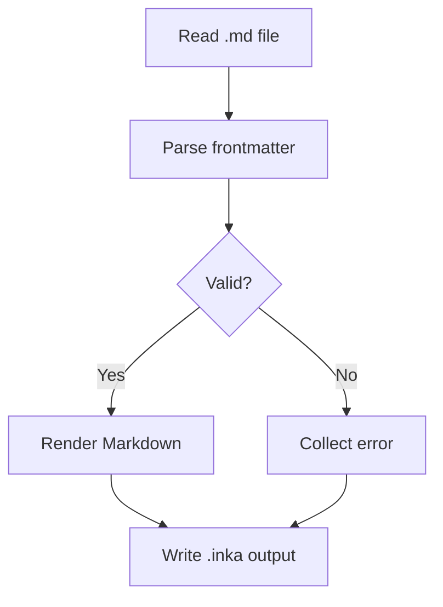

Every file goes through the same four steps. The integrations only decide _when_
the pipeline runs.



1. **Read** the file and split the YAML frontmatter from the body.
2. **Validate** the frontmatter with the Zod schema of the collection.
3. **Render** the Markdown to HTML with GFM and Shiki highlighting.
4. **Write** the entry, the search index and the feeds.

## Errors carry context

A validation error names the file, the field and the reason:

```bash
content/posts/hello.md: "date" — Expected date, received "yesterday"
```

In development the error is printed as a warning and the rest of the content is
still generated. During a production build it fails the build, so broken
frontmatter never reaches the deployment.
