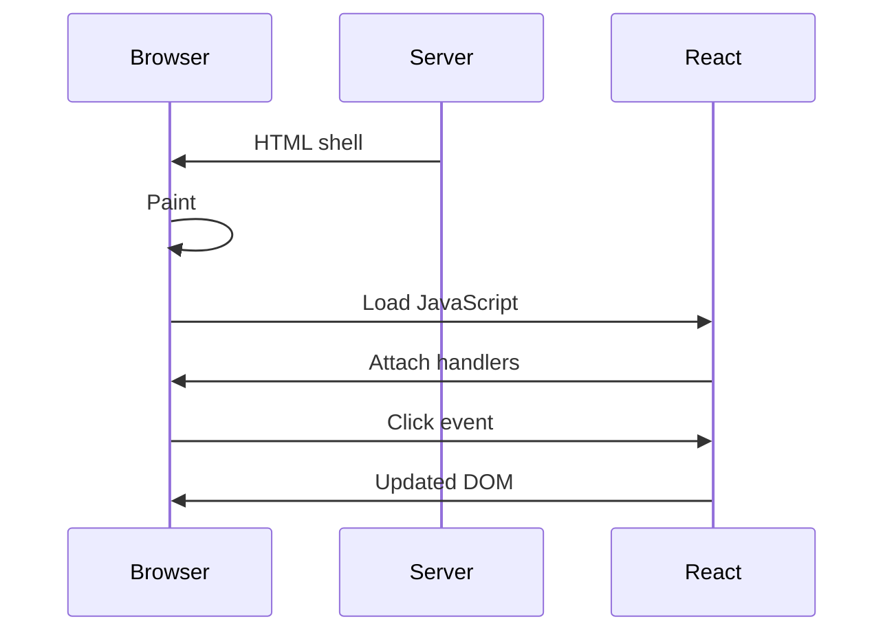

Hydration is the step where React attaches event handlers to the HTML that the
server already sent.

## Why it matters

Before hydration finishes, the page is visible but not interactive. Long
hydration tasks block the main thread, so the click feels lost even though the
button is on screen.

- Keep the initial JavaScript small.
- Split work with `startTransition` or a worker.
- Render diagrams and charts on the client only when the page needs them.
